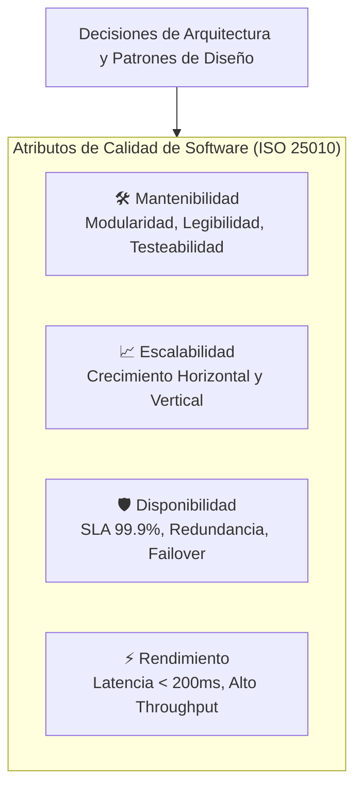
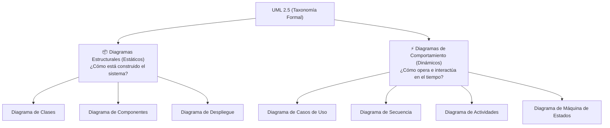
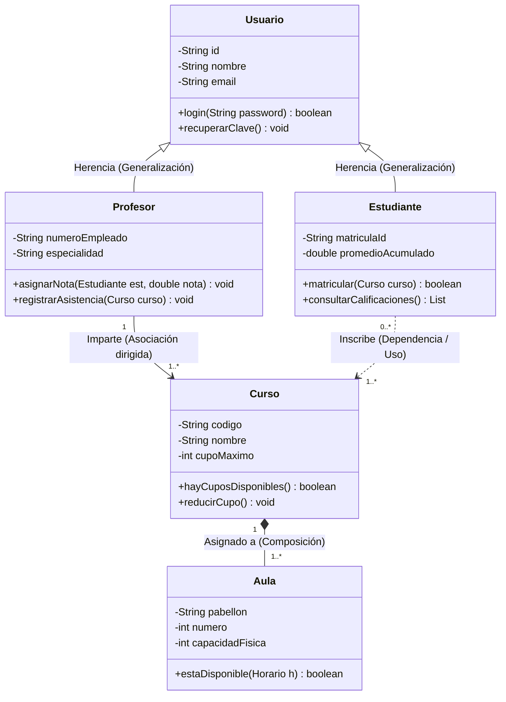
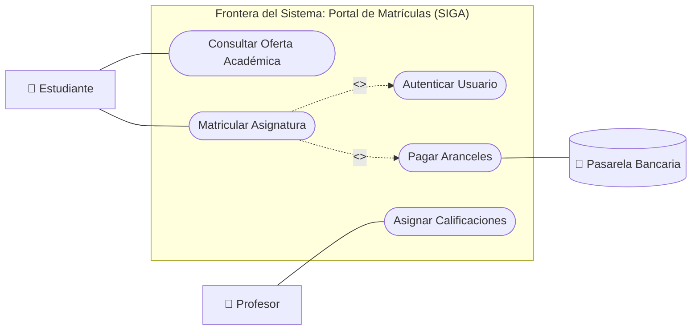
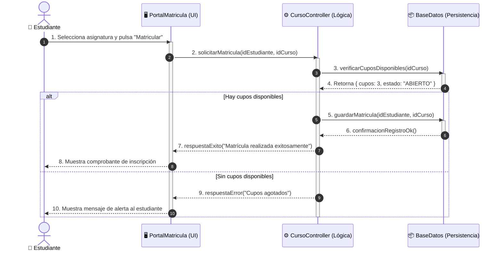
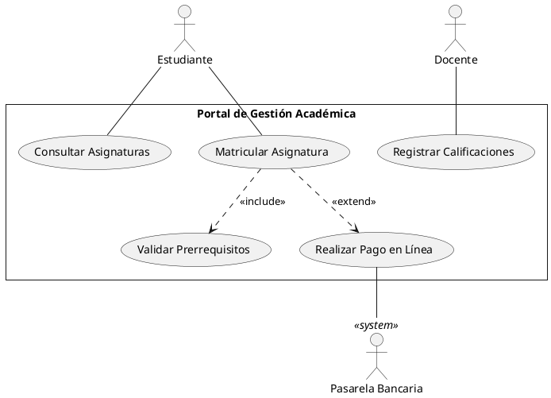

# Clase 2.0: Calidad del Software y Modelado UML

> **Universidad Iberoamericana del Ecuador (UNIBE)**  
> **Carrera:** Ingeniería de Software &middot; Nivel 5  
> **Asignatura:** Diseño y Arquitectura de Software  
> **Docente:** Moreno Moreno Byron Rodrigo  
> **Resultado de Aprendizaje Evaluado:** **RDA2** (Modela soluciones de software mediante el uso de UML y principios de diseño orientado a objetos).

---

## 🎯 1. Objetivos de Aprendizaje

1. **Evaluar la Calidad de Software:** Comprender el impacto de los atributos no funcionales (Mantenibilidad, Escalabilidad, Disponibilidad y Rendimiento) en las decisiones de diseño arquitectónico.
2. **Modelar Estructuras Estáticas:** Representar la anatomía del sistema utilizando Diagramas de Clases UML, especificando visibilidad, atributos, métodos, multiplicidades, generalización y composición.
3. **Modelar Comportamiento Dinámico:** Capturar los escenarios funcionales y el intercambio temporal de mensajes a través de Diagramas de Casos de Uso y Diagramas de Secuencia.

---

## ⚙️ 2. Atributos de Calidad del Software (ISO/IEC 25010)

Los requerimientos no funcionales definen **cómo de bien** debe operar el sistema:

| Atributo de Calidad | Definición de Ingeniería | Métrica de Medición | Estrategia de Diseño Clave |
| :--- | :--- | :--- | :--- |
| **Mantenibilidad** | Facilidad con la que el software puede modificarse, corregirse o evolucionar. | Tiempo Medio de Reparación (MTTR), Cobertura de pruebas, Deuda técnica. | Alta cohesión, bajo acoplamiento, principios SOLID, arquitectura modular. |
| **Escalabilidad** | Capacidad del sistema para manejar incrementos sostenidos en la carga de trabajo sin degradación. | Rendimiento sostenido con incremento de nodos, saturación de CPU/RAM bajo estrés. | Desacoplamiento horizontal, microservicios, bases de datos distribuidas, balanceo de carga. |
| **Disponibilidad** | Porcentaje de tiempo en que el sistema se encuentra operativo y accesible por los usuarios. | Disponibilidad en nueves (ej. 99.9% = SLA &le; 8.76 hrs de inactividad al año). | Redundancia activa-activa, conmutación por error (*failover*), diseño resiliente. |
| **Rendimiento** | Velocidad de respuesta y eficiencia de uso de recursos bajo condiciones normales y pico. | Latencia (ms), transacciones por segundo (TPS), tiempo hasta el primer byte (TTFB). | Caché en memoria (Redis), indexación de BD, consultas asíncronas, *connection pooling*. |

### Mapa Conceptual de Atributos de Calidad

---

## 📐 3. Introducción a UML (Unified Modeling Language 2.5)

UML es el estándar gráfico formal de la industria para modelar sistemas complejos. Se clasifica en dos grandes familias:

---

## 📦 4. Diagramas Estructurales: Diagrama de Clases

El Diagrama de Clases describe las estructuras del dominio, sus datos y operaciones, así como sus relaciones semánticas.

### Ejemplo Gráfico: Modelo de Dominio Académico

### Tabla de Notación y Simbología de Relaciones en Clases

| Relación UML | Símbolo Gráfico | Significado Semántico | Ejemplo del Dominio |
| :--- | :---: | :--- | :--- |
| **Herencia (Generalización)** | `───▷` | Relación "es un" (*is-a*). Especialización de comportamiento. | `Estudiante` es un `Usuario`. |
| **Asociación** | `─────` | Vínculo bidireccional estructural entre clases. | `Profesor` se relaciona con `Curso`. |
| **Asociación Dirigida** | `────>` | Conocimiento unidireccional (A conoce a B, B desconoce a A). | `Profesor` gestiona `Curso`. |
| **Agregación Débil** | `◇───` | Relación todo-parte débil. Si el todo muere, la parte sobrevive. | Un `Departamento` agrupa `Profesores`. |
| **Composición Fuerte** | `◆───` | Relación todo-parte estricta. La parte no puede existir sin el todo. | Un `Curso` contiene sus `Horarios`. |
| **Dependencia** | `- - ->` | Uso transitorio en un método (*uses-a*). | `Estudiante.matricular(Curso c)`. |

---

## ⚡ 5. Diagramas de Comportamiento: Casos de Uso y Secuencia

### 5.1 Diagrama de Casos de Uso (Vista General)

Permite delimitar el **alcance funcional** (*Scope*) y la frontera del sistema frente a los actores externos.

---

### 5.2 Diagrama de Secuencia: Simulación del Flujo de Matrícula

Muestra la comunicación cronológica de mensajes entre objetos para satisfacer el caso de uso `Matricular Asignatura`:

---

## 📝 6. Código PlantUML de Referencia

Para renderizar los diagramas en herramientas como PlantUML o VS Code:

---

## 📌 7. Resumen de Puntos Clave

1. **La Calidad no es accidental:** Los atributos de calidad (mantenibilidad, escalabilidad, disponibilidad) guían las decisiones de descomposición en clases y componentes.
2. **Estructural vs Dinámico:** Las clases y objetos dicen **qué elementos existen**; los casos de uso y secuencias dicen **para qué sirven y cómo cooperan**.
3. **Frontera bien definida:** Un sistema debe tener límites claros; los actores siempre quedan fuera de la frontera.
