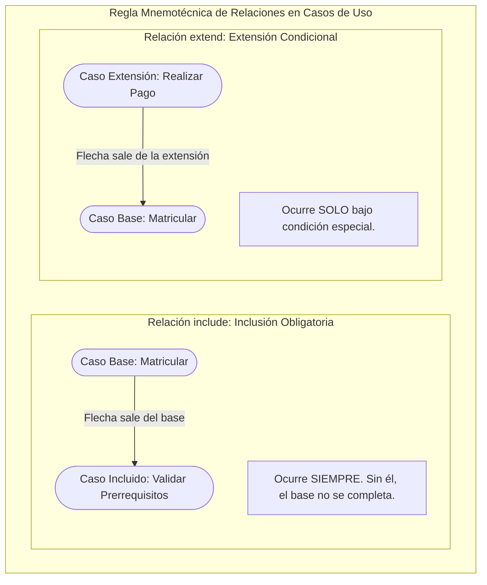
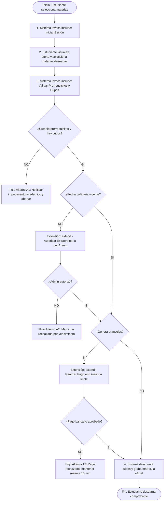
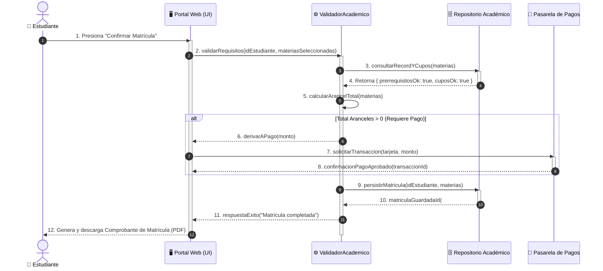
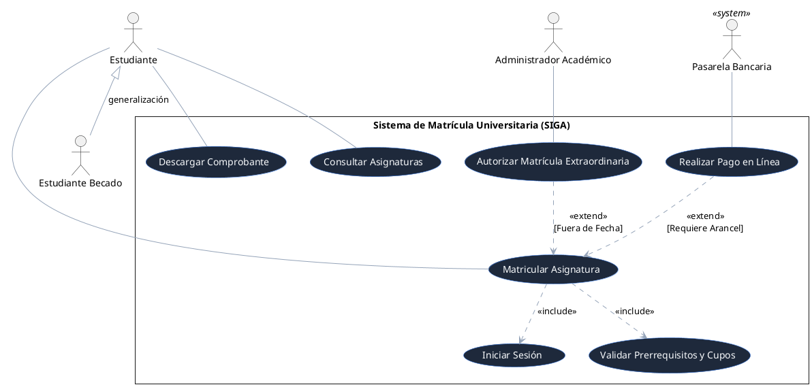

# Clase 2.1: Ejemplo Práctico UML - Casos de Uso del Sistema de Matrículas (SIGA)

> **Universidad Iberoamericana del Ecuador (UNIBE)**  
> **Carrera:** Ingeniería de Software &middot; Nivel 5  
> **Asignatura:** Diseño y Arquitectura de Software  
> **Docente:** Moreno Moreno Byron Rodrigo  
> **Unidad 1:** Fundamentos del Diseño de Software  
> **Resultado de Aprendizaje Evaluado:** **RDA2** (Modela soluciones de software mediante el uso de UML y principios de diseño orientado a objetos).

---

## 🎯 1. Propósito de la Sesión

En esta guía práctica analizaremos en profundidad el modelado de **Diagramas de Casos de Uso**, descomponiendo un caso empresarial real: el **Sistema de Gestión Académica y Matrículas Universitarias (SIGA)**. Aprenderemos a estructurar actores, límites del sistema y las relaciones estereotipadas fundamentales: `<<include>>`, `<<extend>>` y la **Generalización de Actores**.

---

## 📋 2. Requerimientos y Reglas de Negocio del Dominio

Un caso de uso **no** surge de la nada; proviene del levantamiento de reglas de negocio:

1. **Autenticación Obligatoria:** Ningún estudiante puede matricularse si no ha iniciado sesión previamente de forma segura en la plataforma (`<<include>>`).
2. **Validación de Prerrequisitos Académicos:** Al seleccionar asignaturas, el motor debe consultar el récord académico y confirmar que las materias previas fueron aprobadas y que existen cupos disponibles (`<<include>>`).
3. **Pago de Aranceles (Condicional):** Si el estudiante registra materias en segunda/tercera matrícula o excede el límite de créditos gratuitos, el sistema deriva obligatoriamente al pago en línea mediante pasarela bancaria (`<<extend>>`).
4. **Matrícula Extraordinaria (Excepcional):** Si la fecha ordinaria concluyó, la matrícula requiere la autorización explícita del **Administrador de Facultad** (`<<extend>>`).
5. **Roles de Usuario:** Tanto el `Estudiante Regular` como el `Estudiante Becado` son tipos de `Estudiante`, compartiendo el acceso a las funciones base.

---

## 📊 3. Diagrama de Casos de Uso en Forma Gráfica

El siguiente diagrama formal en notación UML representa la frontera del sistema, los actores externos y los vínculos entre casos de uso:

```mermaid
flowchart LR
  %% Límite del Sistema
  subgraph SistemaMatricula ["Límite del Sistema: Plataforma de Matrícula Universitaria - SIGA"]
    direction TB
    
    %% Casos de Uso Base
    UC_Login(["Iniciar Sesión"])
    UC_Consultar(["Consultar Oferta y Horarios"])
    UC_Matricular(["Matricular Asignatura"])
    UC_Prereq(["Validar Prerrequisitos y Cupos"])
    UC_Pago(["Realizar Pago en Línea"])
    UC_Extraord(["Autorizar Matrícula Extraordinaria"])
    UC_Historial(["Descargar Comprobante Oficial"])
  end

  %% Actores Externos (Fuera del límite)
  Estudiante["Estudiante"]
  EstBecado["Estudiante Becado"]
  Admin["Administrador Académico"]
  Banco[("Pasarela Bancaria Externa")]

  %% Generalización de Actores (Herencia)
  EstBecado -->|Generalización| Estudiante

  %% Asociaciones directas Actor -> Caso de Uso
  Estudiante --- UC_Consultar
  Estudiante --- UC_Matricular
  Estudiante --- UC_Historial
  Admin --- UC_Extraord
  Banco --- UC_Pago

  %% Relaciones de Inclusión <<include>> (Siempre obligatorias)
  UC_Matricular -.->|"<<include>>"| UC_Login
  UC_Matricular -.->|"<<include>>"| UC_Prereq

  %% Relaciones de Extensión <<extend>> (Condicionales / Puntos de extensión)
  UC_Pago -.->|"<<extend>> - Requiere Arancel"| UC_Matricular
  UC_Extraord -.->|"<<extend>> - Fuera de Fecha"| UC_Matricular

  %% Estilos visuales
  style SistemaMatricula fill:#0f172a,stroke:#3b82f6,stroke-width:2px,stroke-dasharray: 4 4
  style UC_Matricular fill:#1e3a8a,stroke:#60a5fa,stroke-width:2px,color:#ffffff
  style UC_Login fill:#312e81,stroke:#818cf8,stroke-width:1.5px,color:#ffffff
  style UC_Prereq fill:#312e81,stroke:#818cf8,stroke-width:1.5px,color:#ffffff
  style UC_Pago fill:#064e3b,stroke:#34d399,stroke-width:1.5px,color:#ffffff
  style UC_Extraord fill:#78350f,stroke:#fbbf24,stroke-width:1.5px,color:#ffffff
  style UC_Consultar fill:#1e293b,stroke:#94a3b8,color:#ffffff
  style UC_Historial fill:#1e293b,stroke:#94a3b8,color:#ffffff
```

---

## 🔍 4. Desglose Gráfico: `<<include>>` vs `<<extend>>`

La confusión más común en el modelado UML es la dirección de las flechas punteadas y su significado:

| Criterio | Relación `<<include>>` | Relación `<<extend>>` |
| :--- | :--- | :--- |
| **Obligatoriedad** | **100% Obligatoria.** Es una subrutina indispensable. | **Opcional / Condicional.** Solo se activa bajo ciertas condiciones. |
| **Dirección de la Flecha** | Parte del **Caso Base** $\longrightarrow$ hacia el **Caso Incluido**. | Parte del **Caso Extensión** $\longrightarrow$ hacia el **Caso Base**. |
| **Conocimiento** | El caso base **sabe** que necesita al incluido. | El caso base **ignora** la extensión (el base es autónomo). |
| **Punto de Extensión** | No requiere punto de extensión. | Requiere un **Extension Point** declarado en la especificación. |

---

## 📄 5. Especificación Textual Formal del Caso de Uso

Un diagrama gráfico debe ir acompañado de su especificación formal:

### Formato de Ficha Técnica (Caso de Uso CU-01)

| Campo de Ingeniería | Detalle de la Especificación |
| :--- | :--- |
| **Identificador:** | **CU-01** |
| **Nombre del Caso de Uso:** | **Matricular Asignatura** |
| **Actor Primario:** | `Estudiante` (Humano) |
| **Actores Secundarios:** | `Pasarela Bancaria` (Sistema Externo), `Administrador Académico` |
| **Propósito:** | Permitir al estudiante seleccionar e inscribir formalmente las materias del semestre en curso. |
| **Precondición:** | 1. El periodo lectivo de matrículas debe encontrarse en estado `ACTIVO`. 2. El estudiante debe contar con cuenta activa. |
| **Postcondición Exitosa:** | Materias inscritas en BD con estado `MATRICULADO`, cupos actualizados y comprobante emitido. |
| **Puntos de Extensión:** | - `Punto 1: RequiereArancel` (se dispara si el total de aranceles es $> \$0.00$). - `Punto 2: FueraDePlazo` (se dispara si la fecha actual $>$ fecha límite ordinaria). |

### Flujo de Eventos (Paso a Paso)

---

## 🔄 6. Diagrama de Secuencia de la Interacción Dinámica

Para apreciar cómo los objetos colaboran en tiempo de ejecución para cumplir este caso de uso:

---

## 💻 7. Código Fuente PlantUML (Listo para Exportar)

Puedes copiar y pegar este código en [PlantText](https://www.planttext.com/) o la extensión PlantUML de VS Code:

---

## 💡 8. Criterios de Evaluación y Buenas Prácticas

1. **Evita la sobre-descomposición:** Un caso de uso no es un clic ("Hacer clic en botón aceptar"). Debe representar una transacción completa que ofrezca un valor de negocio medible para el actor.
2. **Los actores representan roles, no personas específicas:** Modela el rol `Estudiante` o `Docente`, nunca a "Juan Pérez" ni "Servidor Dell".
3. **Sentido semántico estricto:**
   - Si una tarea se ejecuta **siempre y forma parte indivisible**, usa `<<include>>`.
   - Si una tarea se ejecuta **solo si se cumple una regla especial de negocio o excepción**, usa `<<extend>>`.
