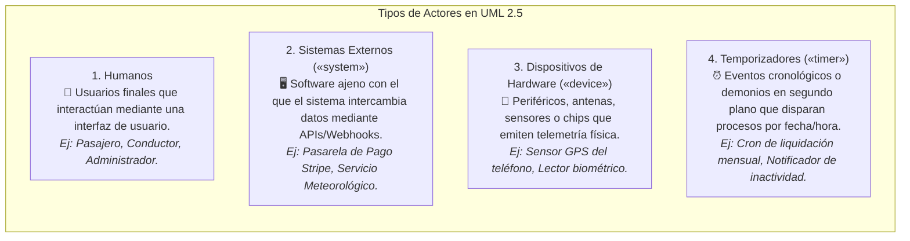
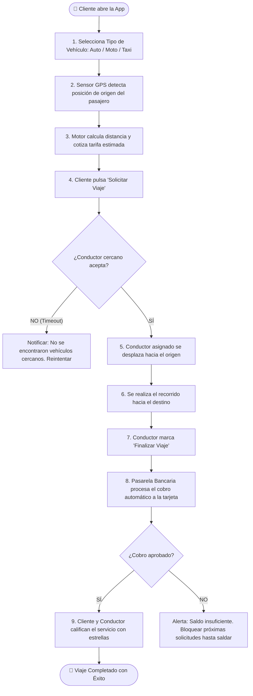
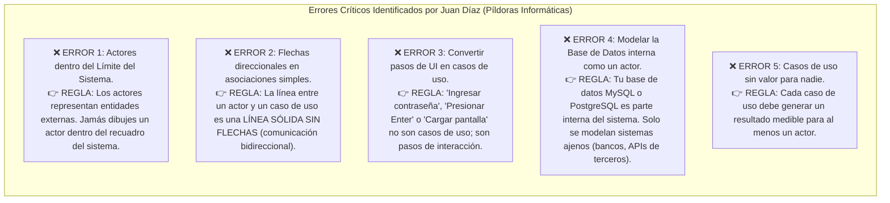
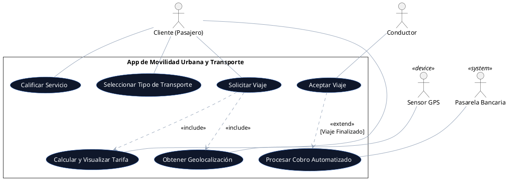

# Clase 2.2: Diagramas de Casos de Uso I - Fundamentos y Aplicación de Transporte Urbano

> **Universidad Iberoamericana del Ecuador (UNIBE)**  
> **Carrera:** Ingeniería de Software &middot; Nivel 5  
> **Asignatura:** Diseño y Arquitectura de Software  
> **Docente:** Moreno Moreno Byron Rodrigo  
> **Referencia Pedagógica:** [Curso UML: Diagramas de Casos de Uso I - Vídeo 5 (*Píldoras Informáticas*)](https://www.youtube.com/watch?v=8IN3xONGMIE&t=3s)  
> **Resultado de Aprendizaje Evaluado:** **RDA2** (Modela soluciones de software mediante el uso de UML y principios de diseño orientado a objetos).

---

## 🎯 1. Objetivos de la Sesión

1. **Apropiar el Enfoque de Caja Negra:** Modelar el comportamiento del sistema desde la óptica de los usuarios y entidades externas, centrándose exclusivamente en **qué hace el sistema** y nunca en **cómo está programado internamente**.
2. **Identificar la Diversidad de Actores:** Reconocer que los actores no solo son personas de carne y hueso, sino también sistemas externos, periféricos de hardware y eventos temporales programados.
3. **Graficar Límites de Sistema y Casos de Uso:** Diseñar un diagrama formal completo para una **App de Movilidad Urbana y Transporte de Pasajeros**, aplicando las reglas de nomenclatura y asociación estándar de UML 2.5.

---

## 💡 2. Fundamentos de los Casos de Uso (Vídeo 5 - Píldoras Informáticas)

### 2.1 El Enfoque de Caja Negra (*Black-Box*)

Un error catastrófico en ingeniería de software es comenzar a modelar casos de uso pensando en tablas de bases de datos, bucles `for` o APIs internas.

```mermaid
flowchart LR
  subgraph Sistema ["SISTEMA DE SOFTWARE (Caja Negra)"]
    Contenido["🔒 Solo nos interesa el QUÉ:<br/>- Servicios provistos<br/>- Respuestas al entorno<br/>- Transacciones completas<br/><br/>❌ NO el CÓMO:<br/>(SQL, Controllers, Variables, Algoritmos)"]
  end

  ActorExterior["👤 Actor Exterior<br/>(Usuario / Sistema / Dispositivo)"] -->|Estimulo / Mensaje| Sistema
  Sistema -->|Valor Observable| ActorExterior

  style Sistema fill:#0f172a,stroke:#3b82f6,stroke-width:2px
  style ActorExterior fill:#1e293b,stroke:#06b6d4,stroke-width:2px
```



---

### 2.2 Tipos de Actores en UML

Un actor representa un **rol** desempeñado frente al sistema. Se clasifican formalmente en 4 categorías:



---

### 2.3 Regla de Oro de Nomenclatura

> [!IMPORTANT]
> Un caso de uso se redacta **SIEMPRE** con la estructura:  
> **Verbo en Infinitivo + Objeto Directo / Complemento**  
> Debe expresar un resultado de valor cuantificable para el actor.

```mermaid
flowchart LR
  subgraph Bien ["✅ Correcto (Orientado al Negocio)"]
    V1(["Solicitar Transporte"])
    V2(["Tarificar Recorrido"])
    V3(["Procesar Pago Bancario"])
  end

  subgraph Mal ["❌ Incorrecto (Orientado a la Implementación)"]
    X1(["Conectar a Base de Datos"])
    X2(["Hacer clic en botón azul"])
    X3(["Ejecutar SELECT * FROM viajes"])
  end

  style Bien fill:#064e3b,stroke:#34d399,stroke-width:2px
  style Mal fill:#450a0a,stroke:#f87171,stroke-width:2px
```



---

## 🚗 3. Caso Práctico Gráfico: App de Transporte Urbano y Movilidad

### 3.1 Descripción del Escenario

Diseñamos la arquitectura funcional para una aplicación móvil de movilidad (tipo Uber / Cabify / Didi) analizada en el vídeo:
- El **Cliente** (pasajero) abre la aplicación móvil, selecciona el tipo de vehículo (estándar, confort, moto o taxi), visualiza la cotización de la tarifa y solicita el viaje.
- El **Dispositivo GPS** del teléfono provee de manera autónoma las coordenadas geográficas de origen del usuario.
- El sistema notifica a los conductores cercanos; el **Conductor** recibe la alerta y acepta la solicitud de viaje.
- Al culminar el trayecto, el sistema liquida el valor automáticamente debitando el monto a través de la **Pasarela de Pago Bancaria**.

---

### 3.2 Diagrama de Casos de Uso Gráfico Completo

```mermaid
flowchart LR
  %% Límite del Sistema
  subgraph AppTransporte ["🚗 Límite del Sistema: App de Movilidad Urbana"]
    direction TB
    
    UC_Vehiculo(["🚗 Seleccionar Tipo de Transporte<br/>(Auto, Moto, Taxi)"])
    UC_GPS(["📍 Obtener Geolocalización de Origen"])
    UC_Cotizar(["💲 Calcular y Visualizar Tarifa"])
    UC_Solicitar(["📲 Solicitar Viaje"])
    UC_Aceptar(["🤝 Aceptar Solicitud de Viaje"])
    UC_Cobrar(["💳 Procesar Cobro Automatizado"])
    UC_Calificar(["⭐ Calificar Servicio y Conductor"])
  end

  %% Actores
  Cliente["👤 Cliente (Pasajero)"]
  Conductor["👤 Conductor"]
  GPS["📡 Sensor GPS Móvil<br/>&laquo;device&raquo;"]
  Banco[("🏦 Pasarela Bancaria<br/>&laquo;system&raquo;")]

  %% Asociaciones Cliente
  Cliente --- UC_Vehiculo
  Cliente --- UC_Cotizar
  Cliente --- UC_Solicitar
  Cliente --- UC_Calificar

  %% Asociaciones Conductor
  Conductor --- UC_Aceptar

  %% Asociaciones Hardware / Sistemas Externos
  GPS --- UC_GPS
  Banco --- UC_Cobrar

  %% Dependencias internas entre Casos de Uso
  UC_Solicitar -.->|&laquo;include&raquo;| UC_GPS
  UC_Solicitar -.->|&laquo;include&raquo;| UC_Cotizar
  UC_Aceptar -.->|&laquo;extend&raquo;<br/>[Viaje Finalizado]| UC_Cobrar

  %% Estilos visuales
  style AppTransporte fill:#0b1329,stroke:#3b82f6,stroke-width:2.5px
  style UC_Vehiculo fill:#1e293b,stroke:#60a5fa,color:#ffffff
  style UC_GPS fill:#1e293b,stroke:#06b6d4,color:#ffffff
  style UC_Cotizar fill:#1e293b,stroke:#60a5fa,color:#ffffff
  style UC_Solicitar fill:#1d4ed8,stroke:#93c5fd,stroke-width:2px,color:#ffffff
  style UC_Aceptar fill:#065f46,stroke:#6ee7b7,stroke-width:2px,color:#ffffff
  style UC_Cobrar fill:#78350f,stroke:#fcd34d,color:#ffffff
  style UC_Calificar fill:#1e293b,stroke:#60a5fa,color:#ffffff
```

---

## 🔄 4. Mapa Gráfico del Flujo de Valor del Servicio

Este diagrama de flujo ilustra cómo se articulan los casos de uso a lo largo del ciclo de vida del servicio:



---

## 📝 5. Ficha Técnica Formal: Caso de Uso "Solicitar Viaje"

| Sección | Descripción Técnica |
| :--- | :--- |
| **Identificador:** | **CU-TR-01** |
| **Nombre:** | **Solicitar Viaje de Transporte** |
| **Actor Primario:** | `Cliente` (Pasajero) |
| **Actores Secundarios:** | `Dispositivo GPS` (`<<device>>`), `Conductor` (Humano), `Pasarela Bancaria` (`<<system>>`) |
| **Descripción:** | Permite al pasajero cotizar, confirmar y solicitar un vehículo de transporte urbano desde su ubicación actual hacia una dirección destino. |
| **Precondición:** | 1. El cliente debe tener sesión iniciada en la aplicación móvil.<br/>2. Debe tener un método de pago válido registrado (tarjeta de crédito/débito o efectivo). |
| **Postcondición:** | Se genera un registro de viaje en estado `SOLICITADO`, con coordenadas, tarifa fijada y emisión de broadcast a los conductores en un radio de 3 km. |

### Flujo Básico y Flujos Alternativos

```
[Flujo Básico Principal]
1. El Cliente selecciona la modalidad de transporte deseada (Coche, Taxi, Moto).
2. El sistema invoca al <<device>> GPS para capturar la geolocalización actual del pasajero.
3. El Cliente ingresa o confirma en el mapa la dirección de destino.
4. El sistema calcula la distancia, el tiempo proyectado y visualiza la tarifa fija garantizada.
5. El Cliente presiona el botón "Confirmar y Solicitar Viaje".
6. El sistema crea la solicitud y emite notificación a los conductores más cercanos.
7. Un Conductor acepta la solicitud y el sistema muestra al Cliente los datos del vehículo y tiempo de llegada.

[Flujo Alternativo A1: Permiso de GPS denegado]
2a. Si el dispositivo GPS no responde o no tiene permisos:
    - El sistema solicita al Cliente que ingrese manualmente su punto de partida en el buscador de direcciones.
    - El flujo continúa en el paso 3.

[Flujo Alternativo A2: Ningún conductor disponible]
7a. Si transcurren 60 segundos sin aceptación de conductores:
    - El sistema amplía el radio de búsqueda a 5 km.
    - Si transcurren otros 60 segundos sin respuesta, notifica al Cliente la indisponibilidad temporal y no genera cobro alguno.
```

---

## 🛑 6. Top 5 Errores Comunes de Modelado en UML (¡No los cometas!)



---

## 💻 7. Código PlantUML de la Aplicación de Transporte

Para compilar y exportar el diagrama de forma profesional:



---

## 🧠 8. Autoevaluación Rápida

1. **¿Por qué el GPS se modela como actor y no como una clase interna?**  
   *Porque es un dispositivo físico externo al software que suministra señales de hardware al límite del sistema.*
2. **¿Por qué la asociación entre el Pasajero y 'Solicitar Viaje' no tiene punta de flecha?**  
   *Porque las asociaciones entre actores y casos de uso en UML representan canales de diálogo interactivo bidireccional.*
3. **¿Cuál es la diferencia entre un diagrama de clases y uno de casos de uso?**  
   *El diagrama de clases es estructural (muestra la arquitectura del código); el de casos de uso es de comportamiento (muestra qué servicios ofrece el sistema).*
