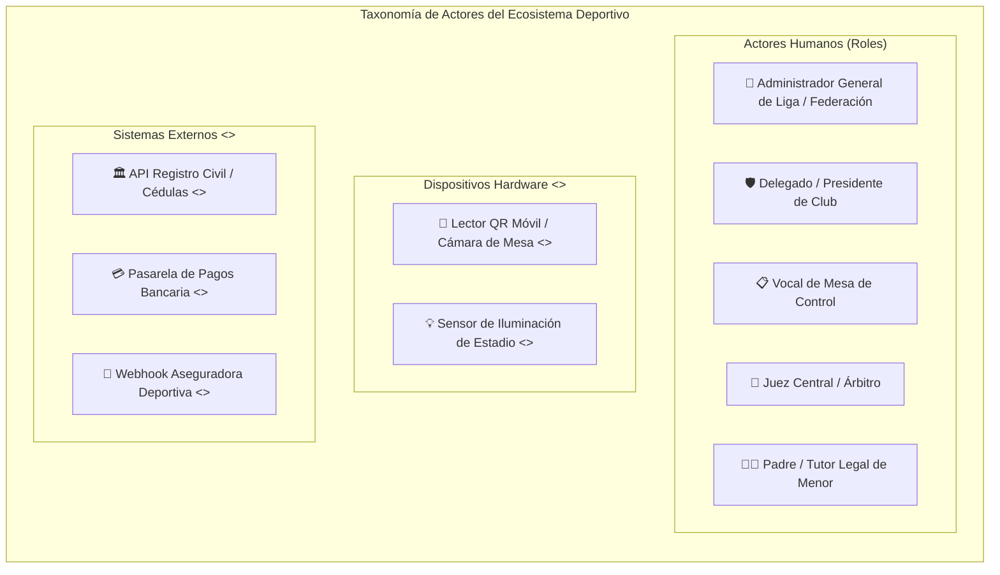
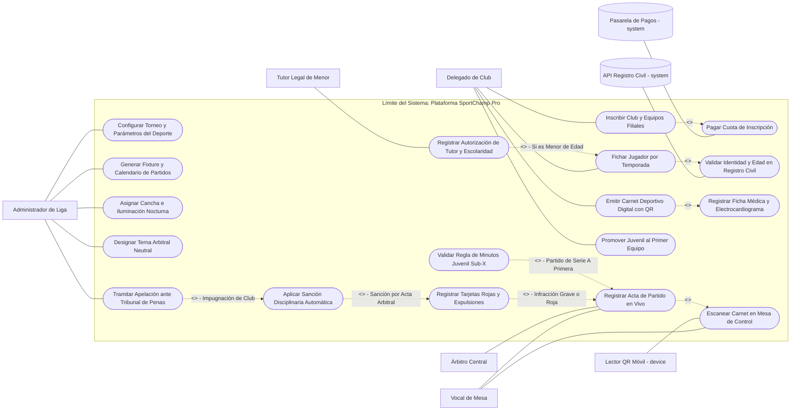
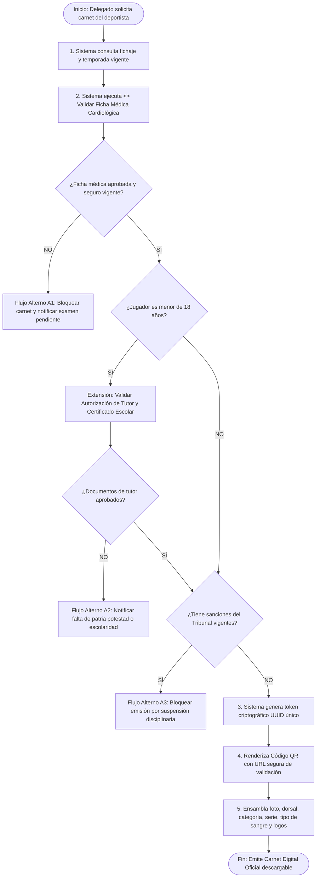
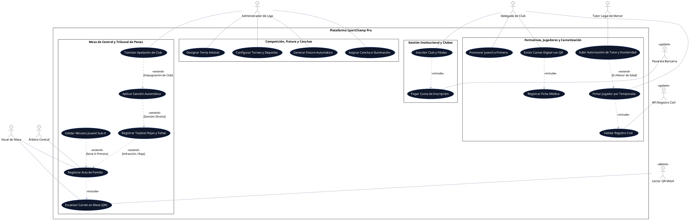

# Propuesta de Solución: Diagrama de Casos de Uso - SportChamp Pro

> **Universidad Iberoamericana del Ecuador (UNIBE)**  
> **Carrera:** Ingeniería de Software &middot; Nivel 5  
> **Asignatura:** Diseño y Arquitectura de Software  
> **Docente:** Moreno Moreno Byron Rodrigo  
> **Unidad 1:** Fundamentos del Diseño de Software & Modelado Orientado a Objetos  
> **Resultado de Aprendizaje Evaluado:** **RDA2** (Modela soluciones de software mediante el uso de UML y principios de diseño orientado a objetos).

---

## 🎯 1. Arquitectura Funcional y Alcance del Sistema

La solución propuesta **SportChamp Pro** modela de forma exhaustiva los procesos de una federación deportiva multideporte (Fútbol 11, Fútbol Sala, Básquetbol, Ecuavóley) y sus ligas filiales.

El alcance del sistema se estructura en **6 subsistemas funcionales**:
1. **Gestión Institucional y Afiliaciones:** Afiliación de clubes, registro de directivas, personerías jurídicas y sedes.
2. **Formativas, Canteras y Tutela Legal:** Registro de menores (Sub-10 a Sub-18), autorización de padres/tutores, certificados escolares y trazabilidad de derechos de formación.
3. **Competición, Series y Fixture:** Parametrización de reglamentos, series (A, B, C), fases, generación automática de calendario y asignación de escenarios.
4. **Infraestructura y Arbitraje:** Programación de estadios según disponibilidad/iluminación y designación de ternas arbitrales neutrales.
5. **Carnetización Inteligente y Control de Acceso:** Ficha médica cardiológica, seguro contra accidentes y emisión de carnet con Código QR de seguridad.
6. **Mesa de Control, Actas Digitales y Tribunal de Penas:** Escaneo en tiempo real, control de minutos del juvenil en cancha (Regla Sub-X), actas de juego, sanciones automáticas y apelaciones.

---

## 👥 2. Clasificación Exhaustiva de Actores del Sistema



---

## 📊 3. Diagrama de Casos de Uso General (Mermaid)

El siguiente diagrama formal representa el límite del sistema (*System Boundary*), los actores y los vínculos estereotipados (`<<include>>` y `<<extend>>`):



---

## 🔍 4. Matriz de Justificación de Relaciones Semánticas

| Relación de Casos de Uso | Tipo UML | Justificación de Ingeniería del Negocio |
| :--- | :---: | :--- |
| `UC_AfiliarClub` $\rightarrow$ `UC_PagarCuota` | `<<include>>` | La afiliación institucional no tiene validez legal sin el abono comprobado de la tasa federativa anual. |
| `UC_FicharJugador` $\rightarrow$ `UC_ValidarRegistroCivil` | `<<include>>` | Para erradicar la suplantación de identidad y adulteración de partidas, el sistema consulta de forma obligatoria el servicio de cédulas. |
| `UC_SubirAutorizacionTutor` $\rightarrow$ `UC_FicharJugador` | `<<extend>>` | **Condicional:** Solo se dispara si la fecha de nacimiento determina que el atleta tiene menos de 18 años (*Punto de extensión: EsMenorDeEdad*). |
| `UC_EmitirCarnet` $\rightarrow$ `UC_RegistrarFichaMedica` | `<<include>>` | No es admisible emitir un carnet con QR habilitado sin la previa aprobación del chequeo cardiológico y póliza vigente. |
| `UC_VerificarReglaSubX` $\rightarrow$ `UC_RegistrarActaPartido` | `<<extend>>` | **Condicional:** Solo se activa en partidos de la categoría Primera División Serie A (*Punto de extensión: RequiereMinutosSubX*). |
| `UC_RegistrarIncidencias` $\rightarrow$ `UC_RegistrarActaPartido` | `<<extend>>` | **Opcional:** Solo ocurre cuando el juez central expulsa jugadores o se reportan desmanes (*Punto de extensión: InfraccionDisciplinaria*). |
| `UC_AplicarSancionAuto` $\rightarrow$ `UC_RegistrarIncidencias` | `<<extend>>` | **Regla de negocio:** Se dispara de manera automática al cerrarse el acta si hay reincidencia de tarjetas amarillas (3) o roja directa. |

---

## 📝 5. Especificaciones Textuales Formales (Fichas Técnicas)

### Ficha Técnica 1: CU-01 &middot; Emitir Carnet Deportivo Digital con QR y Control Juvenil

| Campo | Especificación Formal |
| :--- | :--- |
| **Identificador:** | **CU-01** |
| **Nombre del Caso de Uso:** | **Emitir Carnet Deportivo Digital con QR y Control Juvenil** |
| **Actor Primario:** | `Delegado de Club` (Humano) |
| **Actores Secundarios:** | `Tutor Legal` (Humano), `API Registro Civil` (`<<system>>`), `Lector QR` (`<<device>>`) |
| **Propósito:** | Generar el documento digital de identidad deportiva oficial con token QR criptográfico para que el jugador dispute torneos oficiales. |
| **Precondición:** | 1. El jugador debe tener un fichaje activo en un equipo del club para la temporada en curso.<br/>2. El club debe encontrarse al día en sus obligaciones de tesorería. |
| **Postcondición:** | Carnet generado con estado `HABILITADO`, token QR firmado guardado en base de datos y disponible para descarga en PDF o consulta móvil. |
| **Puntos de Extensión:** | - `Punto 1: MenorDeEdad`: Dispara la verificación de autorización de patria potestad y certificado escolar.<br/>- `Punto 2: HabilitacionSubX`: Si es juvenil promovido al primer equipo, incorpora la marca especial de Regla Sub-X en el carnet. |

#### Flujo de Eventos (Paso a Paso)



---

### Ficha Técnica 2: CU-02 &middot; Registrar Acta de Partido en Vivo y Control de Minutos Sub-X

| Campo | Especificación Formal |
| :--- | :--- |
| **Identificador:** | **CU-02** |
| **Nombre del Caso de Uso:** | **Registrar Acta de Partido en Vivo y Control de Minutos Sub-X** |
| **Actor Primario:** | `Vocal de Mesa de Control` (Humano) |
| **Actores Secundarios:** | `Árbitro Central` (Humano), `Lector QR Móvil` (`<<device>>`) |
| **Propósito:** | Controlar las alineaciones previas al partido, registrar minuto a minuto las incidencias (goles, cambios, tarjetas) y fiscalizar los 45 minutos obligatorios de juvenil en cancha. |
| **Precondición:** | El partido debe estar programado en fixture en fecha, hora y estadio habilitado. |
| **Postcondición:** | Acta firmada digitalmente, marcador oficializado, tabla de posiciones actualizada y reporte disciplinario emitido. |

#### Flujo Básico y Alternativos

```
[Flujo Básico Principal]
1. El Vocal de Mesa abre la sesión del partido en la plataforma móvil o tablet.
2. El Vocal invoca <<include>> Escanear Carnet en Mesa de Control para cada uno de los 11 titulares y 7 suplentes de cada club.
3. El dispositivo <<device>> valida que los 18 carnets de cada equipo estén en estado HABILITADO y sin sanciones.
4. Si el partido corresponde a Serie A Primera División, el sistema ejecuta la extensión <<extend>> Validar Regla Sub-X, requiriendo identificar al jugador juvenil Sub-18 titular.
5. El Árbitro Central da inicio al encuentro y el Vocal activa el cronómetro digital del acta.
6. A lo largo del partido, el Vocal registra: goles (jugador, minuto, tipo), sustituciones (sale dorsal X, entra dorsal Y, minuto) y amonestaciones.
7. Al cumplirse los 45 minutos reglamentarios, el sistema valida si el juvenil Sub-18 completó el tiempo mínimo obligatorio.
8. Al terminar el partido, el Árbitro Central y ambos Capitanes revisan las incidencias y firman digitalmente el acta en pantalla.
9. El sistema cierra el acta, actualiza puntos, goles a favor/contra y Fair Play en la tabla de posiciones.

[Flujo Alternativo A1: Carnet no habilitado o adulterado]
3a. Si un carnet escaneado aparece en estado SANCIONADO o NO HABILITADO:
    - El sistema emite alarma sonora y visual en la tablet del vocal.
    - Se impide incluir al jugador en la planilla oficial de juego.
    - El delegado dispone de 10 minutos para inscribir a otro jugador con carnet habilitado.

[Flujo Alternativo A2: Incumplimiento de la Regla Sub-X]
7a. Si el DT sustituye al juvenil antes del minuto 45 sin ingresar a otro jugador juvenil elegible:
    - El sistema registra la infracción con sello de tiempo y observación técnica automática.
    - Al cerrarse el acta, el partido se remite con marca de "Impugnación Automática" al Tribunal de Penas para la pérdida reglamentaria de puntos.
```

---

## 💻 6. Código Fuente PlantUML del Diagrama de Casos de Uso


