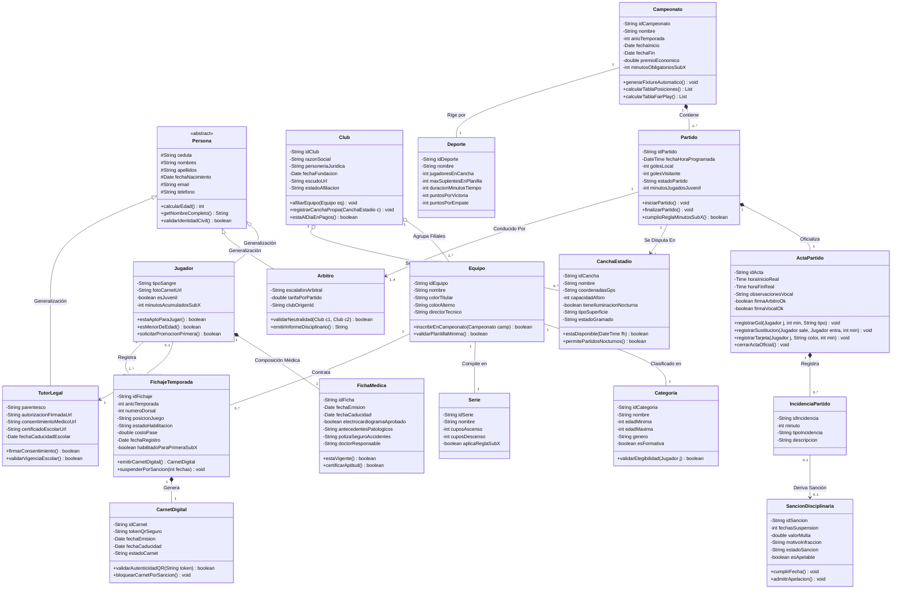
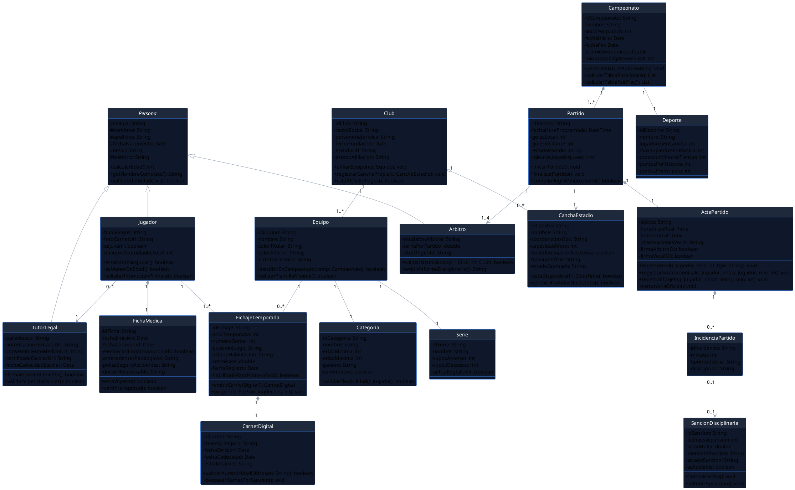

# Propuesta de Solución: Diagrama de Clases del Dominio - SportChamp Pro

> **Universidad Iberoamericana del Ecuador (UNIBE)**  
> **Carrera:** Ingeniería de Software &middot; Nivel 5  
> **Asignatura:** Diseño y Arquitectura de Software  
> **Docente:** Moreno Moreno Byron Rodrigo  
> **Unidad 1:** Fundamentos del Diseño de Software & Modelado Orientado a Objetos  
> **Resultado de Aprendizaje Evaluado:** **RDA2** (Modela soluciones de software mediante el uso de UML y principios de diseño orientado a objetos).

---

## 🎯 1. Modelo de Dominio de Clases: Visión de Ingeniería

El presente modelo estructural organiza la arquitectura orientada a objetos de la plataforma **SportChamp Pro**. Satisface el principio de **alta cohesión y bajo acoplamiento**, aislando las responsabilidades administrativas, deportivas, médicas, formativas, arbitrales y disciplinarias.

### Principios de Modelado Aplicados:
1. **Generalización (Herencia):** La clase abstracta `Persona` centraliza los datos de identidad civil comunes a `Jugador`, `Arbitro` y `TutorLegal`.
2. **Composición Fuerte (◆):**
   * Un `Jugador` es dueño de su `FichaMedica` (la ficha carece de existencia sin el atleta).
   * Un `Campeonato` contiene compositivamente sus `Fases` y `Partidos`.
   * Un `Partido` contiene obligatoriamente su `ActaPartido`, y esta contiene sus `Incidencias`.
3. **Agregación Débil (◇):**
   * Un `Club` agrupa a sus `Equipos` filiales y sus `CanchasEstadios` sedes. Si el club se desafilia, los escenarios y equipos pueden reasignarse.
4. **Clase Asociativa Central:**
   * `FichajeTemporada` resuelve la relación de muchos a muchos ($N:M$) entre `Jugador`, `Equipo` y `Temporada/Año`, modelando el dorsal, costo del pase y la habilitación de canteras para primera división (**Regla Sub-X**).

---

## 📊 2. Diagrama de Clases del Dominio en Notación Mermaid

---

## 📖 3. Diccionario de Clases, Responsabilidades y Métodos

### 3.1 Entidades de Identidad y Personas

| Clase | Responsabilidad de Negocio | Atributos Críticos | Métodos de Dominio |
| :--- | :--- | :--- | :--- |
| **`Persona`** *(Abstract)* | Superclase que centraliza los datos de identidad civil y cálculos de edad cronológica. | `cedula`, `nombres`, `apellidos`, `fechaNacimiento`, `email`, `telefono` | `calcularEdad(): int` `validarIdentidadCivil(): boolean` |
| **`Jugador`** | Modela al deportista federado, su estado físico y su condición de formativa / primera. | `tipoSangre`, `fotoCarnetUrl`, `esJuvenil`, `minutosAcumuladosSubX` | `estaAptoParaJugar(): boolean` `esMenorDeEdad(): boolean` `solicitarPromocionPrimera(): boolean` |
| **`TutorLegal`** | Modela la patria potestad sobre atletas menores de edad y el control escolar. | `parentesco`, `autorizacionFirmadaUrl`, `consentimientoMedicoUrl`, `certificadoEscolarUrl` | `firmarConsentimiento(): boolean` `validarVigenciaEscolar(): boolean` |
| **`Arbitro`** | Representa al juez colegiado encargado de dirigir y fiscalizar el reglamento. | `escalafonArbitral`, `tarifaPorPartido`, `clubOrigenId` | `validarNeutralidad(Club, Club): boolean` `emitirInformeDisciplinario(): String` |

---

### 3.2 Entidades Institucionales y Competición

| Clase | Responsabilidad de Negocio | Atributos Críticos | Métodos de Dominio |
| :--- | :--- | :--- | :--- |
| **`Club`** | Persona jurídica titular de franquicias, canchas y equipos filiales. | `razonSocial`, `personeriaJuridica`, `escudoUrl`, `estadoAfiliacion` | `afiliarEquipo(Equipo): void` `estaAlDiaEnPagos(): boolean` |
| **`Equipo`** | Plantilla representativa que compite en una serie y categoría específica. | `nombre`, `colorTitular`, `colorAlterno`, `directorTecnico` | `inscribirEnCampeonato(Camp): boolean` `validarPlantillaMinima(): boolean` |
| **`Categoria`** | Delimita las cotas etarias y formativas (Sub-10 hasta Supermáster). | `nombre`, `edadMinima`, `edadMaxima`, `genero`, `esFormativa` | `validarElegibilidad(Jugador): boolean` |
| **`Serie`** | Estructura los niveles competitivos (Serie A, B, C) y ascensos/descensos. | `nombre`, `cuposAscenso`, `cuposDescenso`, `aplicaReglaSubX` | — |
| **`Campeonato`** | Conduce el torneo deportivo, fixtures, tablas de posiciones y Fair Play. | `nombre`, `anioTemporada`, `premioEconomico`, `minutosObligatoriosSubX` | `generarFixtureAutomatico(): void` `calcularTablaPosiciones(): List` `calcularTablaFairPlay(): List` |

---

### 3.3 Entidades Asociativas, Carnetización y Control de Juego

| Clase | Responsabilidad de Negocio | Atributos Críticos | Métodos de Dominio |
| :--- | :--- | :--- | :--- |
| **`FichajeTemporada`** *(Clase Asociativa)* | Modela el pase/contrato de un jugador con un club en una temporada específica. | `anioTemporada`, `numeroDorsal`, `posicionJuego`, `estadoHabilitacion`, `costoPase` | `emitirCarnetDigital(): CarnetDigital` `suspenderPorSancion(int): void` |
| **`CarnetDigital`** | Credencial oficial con QR criptográfico para autenticación en mesa de control. | `tokenQrSeguro`, `fechaEmision`, `fechaCaducidad`, `estadoCarnet` | `validarAutenticidadQR(token): boolean` `bloquearCarnetPorSancion(): void` |
| **`Partido`** | Instancia de juego programada en un estadio con terna y marcador oficial. | `fechaHoraProgramada`, `golesLocal`, `golesVisitante`, `minutosJugadosJuvenil` | `iniciarPartido(): void` `cumplioReglaMinutosSubX(): boolean` |
| **`ActaPartido`** | Ficha jurídica oficial donde el vocal y árbitro dan fe de las incidencias del cotejo. | `horaInicioReal`, `horaFinReal`, `observacionesVocal`, `firmaArbitroOk` | `registrarGol(Jugador, int): void` `registrarSustitucion(...): void` `cerrarActaOficial(): void` |
| **`SancionDisciplinaria`** | Resolución de penalizaciones emitida por acumulación o tribunal de penas. | `fechasSuspension`, `valorMulta`, `motivoInfraccion`, `estadoSancion` | `cumplirFecha(): void` `admitirApelacion(): void` |

---

## 🔗 4. Mapeo de Trazabilidad: Casos de Uso $\longleftrightarrow$ Diagrama de Clases

| Caso de Uso Funcional | Clases Participantes del Dominio | Métodos Clave Invocados |
| :--- | :--- | :--- |
| **CU-01: Emitir Carnet Digital con QR** | `FichajeTemporada`, `Jugador`, `FichaMedica`, `TutorLegal`, `CarnetDigital` | `FichaMedica.estaVigente()` `TutorLegal.validarVigenciaEscolar()` `FichajeTemporada.emitirCarnetDigital()` |
| **CU-02: Registrar Acta y Minutos Sub-X** | `Partido`, `ActaPartido`, `IncidenciaPartido`, `Jugador`, `CarnetDigital` | `CarnetDigital.validarAutenticidadQR()` `ActaPartido.registrarSustitucion()` `Partido.cumplioReglaMinutosSubX()` |
| **CU-03: Procesar Sanción Disciplinaria** | `ActaPartido`, `IncidenciaPartido`, `SancionDisciplinaria`, `FichajeTemporada` | `IncidenciaPartido.derivarSancion()` `SancionDisciplinaria.aplicarSancion()` `FichajeTemporada.suspenderPorSancion()` |
| **CU-04: Generar Fixture y Asignar Canchas** | `Campeonato`, `Partido`, `CanchaEstadio`, `Arbitro` | `CanchaEstadio.estaDisponible()` `Arbitro.validarNeutralidad()` `Campeonato.generarFixtureAutomatico()` |

---

## 💻 5. Código Fuente PlantUML del Diagrama de Clases

